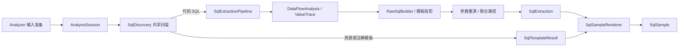

# 分析入口与扩展

用户始终引入 `jsqlint-core`，按需求添加 `jsqlint-commons`、`jsqlint-jdbc`、
`jsqlint-mybatis`。core 不依赖这些可选模块，也不引入 Maven/Gradle 编译依赖。
旧 `jsqlint-analysis` 保持独立，未接入新流程。

## 职责与处理链

| 组件 | 职责 |
|---|---|
| `Analyzer` | 输入准备、所有权和结束清理，解析实例配置与单次覆盖 |
| `AnalysisSession` | 取消、超时、阶段进度、诊断、结果保存与监听器交付 |
| `SqlSeedCompatibility` | 旧 ValueAt 起点与完整提取结果的匹配、复用和事件投影 |
| `SqlDiscovery` | 每次注册模块，共享资源和代码扫描，收集起点及应用调用点 |
| `ProgramIndex` / `DataFlowAnalysis` | 调用上下文、应用类分派、局部与过程间来源追踪 |
| `SqlExtractionPipeline` | 组织 raw SQL 恢复、模板投影、参数重演与联合路径推断 |
| `TemplateExtractionPipeline` | 将资源定义与实参关联，共用值传播和联合推断，保存参数化 SQL 模型 |
| JDBC / MyBatis 适配层 | 定位框架来源，处理绑定、批次、XML 标签和 include 语义 |
| `SqlSampleRenderer` | 从已保存结果生成统一样例，保留类型、来源、可行性和证据 |
| `SqlAnalysisLogger` | 展示结果和传播链；关闭 INFO 日志时直接跳过遍历 |



代码提取共用 `DataFlowAnalysis → ValueTrace → RawSqlBuilder`。`SqlTemplateProjection`
从这些结果派生模板，只折叠已知输入；旧 `onSql` 事件使用同一来源的模板，
不再运行另一套 SQL 值传播算法。复用按模块、调用位置和实际 SQL 输入匹配，
同一调用上的其他输入仍单独恢复。未注册完整提取规则的旧 `ValueAt` 起点继续提供模板结果。
旧 `ValueTraceAnalyzer` 保留构造方式，已标记弃用并改为共享数据流的兼容入口。
兼容模板按项目内已索引的调用上下文派生：唯一已知文本可以折叠，多个文本仍保留选择节点；
未解析的入口输入继续保持符号值。完整模板对应这些调用上下文，其路径可行性继续由联合结果判断。

纯 Java 运算模型位于 `core.semantics`，由来源追踪、参数重演和条件求值共用；
SQL 恢复和模板投影实现位于 `core.template`。旧包中的同名入口保留弃用委托，支持既有调用方迁移。
`ValueTrace.Computation` 使用独立操作种类表达非空检查、String 拷贝/转型和 `String.concat`，
这些操作的显示文案不参与求值。旧快照使用的固定文案仅在构造边界转换为明确操作。

独立重演和条件求解共用 `JavaValueOperations.evaluate` 执行带类型的已知操作数，
来源选择与证据由重演器管理，符号比较、约束和搜索由求解器管理。
联合求解及前缀剪枝均使用实际的参数文本长度预算。无参 `String.toLowerCase/toUpperCase`
依赖目标 JVM 的默认 Locale，目前保留为未知操作，不使用分析进程的 Locale 生成确定值。

MyBatis 自己校验框架标签、展开 include，将 XML/注解转换为 core 的不可变 SqlDefinition。
Mapper 调用通过 TemplateSqlInput 关联真实实参，由 core 统一溯源、联合重演和参数化渲染。
字节码参数名称与注解的读取位于 core，@Param 等框架规则由 MyBatis 模块解释。
原有 core XML DSL 继续可用；其 `literal`、`value`、`skipBlank` 扩展不属于 MyBatis 语法。

## 统一入口

```java
import org.u80dc.jsqlint.core.Analyzer;
import org.u80dc.jsqlint.core.AnalyzerConfig;
import org.u80dc.jsqlint.core.AnalysisOptions;
import org.u80dc.jsqlint.core.AnalysisResult;
import java.nio.file.Path;
import java.time.Duration;

var analyzer = new Analyzer();
AnalysisResult result = analyzer.analyze(Path.of("target/classes"));
// 引入 commons 后，同一入口可以接收 .java 文件、源码目录、Maven/Gradle 项目：
AnalysisResult projectResult = analyzer.analyze(Path.of("project"), Path.of("libraries"),
        AnalysisOptions.defaults());

// 指定本次编译的输出标识，实际路径为 ${java.io.tmpdir}/.jsqlint/my-project/。
var options = AnalysisOptions.defaults()
        .withClassOutputId("my-project")
        .withCleanupClassOutput(true); // 本次分析结束后清理输出。
AnalysisResult compiledResult = analyzer.analyze(Path.of("project"), options);
```

- Path 入口自动加入当前 JDK 运行时；三参数入口的 dependencies 可以为 null、依赖 JAR、类目录或包含依赖 JAR 的目录。
  依赖目录本身和其中递归查找的 JAR 均作为 Library。
- core 内置字节码目录、JAR、单个 class 文件支持。单个 class 从字节码读取实际类名。
- commons 提供 `AnalysisInputResolver`，使用已有的 `AutoCompileAnalysisInputLocation`。
  高优先级解析器优先，同级冲突明确报错；编译失败不回退到陈旧字节码。
  可通过 `AnalysisOptions.withClassOutputId(...)` 指定输出标识，Analyzer 生成
  `${java.io.tmpdir}/.jsqlint/<指定标识>/`；未指定时生成 `${java.io.tmpdir}/.jsqlint/<随机标识>/`。
  Analyzer 始终将完整路径传给解析器，再传入 `AutoCompileAnalysisInputLocation`，不回退到解析器配置的路径。
  标识必须是单个非空目录名；同一标识复用同一路径，每次编译前递归清空该目录中的原有内容。
  默认在分析结束后保留产物；`withCleanupClassOutput(true)` 在关闭输入后删除本次输出目录，
  成功、失败、取消或超时均执行。清理失败会报告诊断并返回 FAILED。
  同一标识用于顺序复用；并发分析应使用不同标识或默认的随机标识。
  清理不越过输出目录，不允许输出目录包含源码或依赖，也不允许输出根目录通过链接重定向。
  已编译字节码无需输出目录；列表和 AnalysisRequest 入口直接使用调用方提供的输入，不再次编译。
  这些入口不清理编译输出目录，即使指定的标识已有对应目录。
- Path 入口关闭自身创建的输入，包括取消和失败的情况。
- `analyze(List<? extends AnalysisInputLocation>)` 保留调用方输入顺序和 SourceType，
  不自动添加运行时，不关闭调用方输入，也不猜测其资源路径。

显式提供代码、资源和本次执行选项：

```java
var request = new AnalysisRequest(
    locations,
    List.of(new PathResourceSource(Path.of("src/main/resources"))),
    AnalysisOptions.defaults());
AnalysisResult result = analyzer.analyze(request);
```

允许仅分析资源，但代码和资源不能同时为空。资源来源接口也支持自定义内存、归档或远程资源，
不要求存在本地 Path。远程访问策略由资源实现控制。

commons 的项目资源默认扫描项目目录，排除 src/test、target、build、.git、.gradle、.idea；
特殊资源目录、构建生成资源或依赖中的资源可通过 AnalysisRequest 显式提供。

## 路径绑定入口

同一目标需要多次分析时，可通过 `bind` 固定路径并复用原 Analyzer 的配置、模块和输入解析器：

```java
var analyzer = new Analyzer(AnalyzerConfig.defaults());
var bound = analyzer.bind(Path.of("target/classes"));
var withDependencies = analyzer.bind(Path.of("target/classes"), Path.of("libraries"));

AnalysisResult all = bound.analyze();
AnalysisResult allWithOptions = bound.analyze(AnalysisOptions.defaults());
String entry = "com/example/UserMapper.findUsers:(Ljava/lang/String;)Ljava/util/List;";
AnalysisResult selected = withDependencies.analyze(entry);
AnalysisResult selectedWithOptions = withDependencies.analyze(AnalysisOptions.defaults(), entry);
```

`bind(Path)` 和 `bind(Path, Path)` 返回不可变的 `BoundAnalyzer`，仅保存原 Analyzer 及规范化的绝对路径。
依赖参数允许 null，其 JAR、类目录和递归依赖扫描规则与原 Path 入口相同，仅用于额外分析依赖。
绑定时不检查文件存在性、不扫描依赖、不编译；允许先绑定尚未生成的编译输出目录，文件校验仍在分析时执行。

四个 `analyze` 方法全部委托原入口，沿用同一个结果契约、两种完整方法签名格式、默认配置和单次选项规则。
绑定对象不保存监听器、取消信号或方法范围；切换目标时创建另一绑定对象，原 Analyzer 仍可分析其他输入。
每次分析读取当时的程序内容，重新准备输入并创建独立会话、程序视图和索引。
输入关闭、输出清理及并发约定沿用原入口；绑定对象不持有活动输入，无需关闭。

## 指定方法及下游 SQL

`analyze` 的方法范围重载同时接收完整 SootUp 方法签名和 JVM 方法引用，返回同一 `AnalysisResult`：

```java
String entry = "<com.example.OrderService: void queryOrders(java.sql.Connection,java.lang.String)>";
AnalysisResult result = analyzer.analyze(Path.of("target/classes"), AnalysisOptions.defaults(), entry);
AnalysisResult withDependencies = analyzer.analyze(Path.of("target/classes"), Path.of("libraries"),
        AnalysisOptions.defaults(), entry);
AnalysisResult prepared = analyzer.analyze(request, entry);

var sqls = result.rawSqls();
var definitions = result.definitions();
var problems = result.diagnostics();
```

完整签名包含所属类型、返回类型、方法名及全部参数类型，按擦除后的字节码类型区分重载。
以下两种写法等价，三个方法范围重载都支持这两种格式，忽略输入首尾空白：

```text
<com.example.UserMapper: java.util.List findUsers(java.lang.String)>
com/example/UserMapper.findUsers:(Ljava/lang/String;)Ljava/util/List;
```

JVM 方法引用格式为 `owner.method:(参数描述符)返回描述符`。所属类和对象类型使用 `/` 分隔包名，
嵌套类保留 `$`；例如 `com/example/Outer$Inner`。裸描述符 `(Ljava/lang/String;)Ljava/util/List;`
不包含所属类和方法名，无法定位目标方法，因此不接受。
基本类型使用 `B`（byte）、`C`（char）、`D`（double）、`F`（float）、`I`（int）、`J`（long）、
`S`（short）、`Z`（boolean），无返回值使用 `V`；对象类型使用 `L内部类名;`，数组每一维增加一个 `[`。
例如 `String[]` 为 `[Ljava/lang/String;`，`int[][]` 为 `[[I`；构造器使用 `<init>`，返回类型为 `V`。
两种输入都转换为同一个 SootUp 方法签名后复用现有分析流程，结果中的方法签名保持 SootUp 标准格式。

签名格式错误在执行前抛出 `IllegalArgumentException`；方法不存在按现有执行失败机制返回
`FAILED` 和诊断。没有关联 SQL 且分析完成时，返回 `SUCCESS` 和空集合。

分析范围包含指定方法以及现有调用解析能力能够关联的下游方法，保留同一入口内不同调用点的上下文。
指定方法作为独立入口，其参数与接收者状态沿用现有外部值和推断机制，不枚举上游调用者的实参。
调用索引仍基于完整应用代码建立，输入准备、模块注册、资源索引和类路径解析与原入口共用。
原有 `analyze` 重载保持全程序分析范围；一次调用的入口状态不会保存在 Analyzer 实例中。

支持直接指定没有调用方、没有方法体的 Mapper 接口方法：

```java
AnalysisResult mapper = analyzer.analyze(Path.of("target/classes"), AnalysisOptions.defaults(),
        "<com.example.UserMapper: java.util.List findUsers(java.lang.String)>");
```

启用 MyBatis 模块后，XML、SQL 注解及 Provider 的定义关联复用该模块现有规则。
直接 Mapper 入口产生定义结果，实际下游 Mapper 调用仍产生调用提取结果；不会伪造 Java 调用语句。
继承方法保留请求接口的 namespace，默认方法按普通 Java 方法体分析。
同一文本的不同调用点和来源继续分别保存在现有结果中。

无法关联 Mapper 定义、必要模块未启用、未知项目/第三方下游调用、反射、未支持的动态调用、
递归入口或调用预算截断均通过现有诊断机制返回 `PARTIAL`，保留已经提取的 SQL。
直接指定未纳入应用代码索引的库方法体时，同样报告范围受限，不将空集合判定为完整覆盖。
SQL 集合为空时也保留整体诊断。运行时基础库不展开为应用方法体；已支持的标量字符串拼接
按共享 Java 语义处理，未知运行时回调不承诺完整覆盖。

方法定义扩展可以在 `DiscoveryRegistry.methodDefinition(...)` 中注册回调。
该回调在资源和代码索引就绪后执行，接收请求签名、解析后的方法声明、程序视图与
`Consumer<AnalysisSeed>`，输出仍使用 `SqlInput.Definition` 或 `SqlInput.ComputedDefinition`。
原有方法级起点可直接复用；全程序定义发现继续使用 `afterDiscovery(...)`。
模块未关联到该方法时发出零个起点，由 core 汇总全部模块；所有模块均未提供来源时才报告入口定义不可用。

## 实例配置与单次选项

可复用的默认配置在创建 Analyzer 时传入，只对该实例生效：

```java
var config = AnalyzerConfig.defaults()
        .withTimeout(Duration.ofMinutes(5))
        .withMaxCallDepth(32)
        .withMaxTraceDepth(256)
        .withMaxTraceNodes(10000)
        .withMethodCacheSize(128)
        .withCleanupClassOutput(true);
var analyzer = new Analyzer(config);

analyzer.analyze(Path.of("project-a")); // 使用实例默认配置。
var options = AnalysisOptions.defaults()
        .withClassOutputId("project-b")
        .withTimeout(Duration.ZERO)
        .withCleanupClassOutput(false);
analyzer.analyze(Path.of("project-b"), options); // 仅本次不限时并保留产物。
analyzer.analyze(Path.of("project-c")); // 仍使用五分钟超时和结束清理。
```

| 配置归属 | 内容 |
|---|---|
| `AnalyzerConfig` | 默认超时、调用深度、数据依赖深度与节点预算、方法缓存容量、默认结束清理策略、输入扩展配置、SQL 恢复/参数重演/联合求解预算、推断策略 |
| `AnalysisOptions` | 本次超时覆盖、取消信号、监听器、输出标识、结束清理覆盖、推断策略覆盖、统计收集选项 |

配置优先级为：单次显式覆盖 → Analyzer 实例默认值；`AnalyzerConfig.defaults()` 提供系统默认值：
不限时、调用深度 32、数据依赖深度 256、单次溯源访问节点数 10000、方法缓存容量 128、保留编译产物、
联合求解预算见下文。
`withMaxTraceDepth` 现在只调整数据依赖展开深度，不再改变调用栈预算；调用深度使用 `withMaxCallDepth`。
旧的四参数、五参数构造器仍将显式传入的共享深度同时用于调用和数据依赖，保持原构造方式的含义。

SQL 恢复和参数重演有独立容量；提高来源追踪深度不会隐式放宽后续阶段。
默认值保持原有行为，各项均须为正，可通过对应的 with 方法单项调整：

| 阶段配置 | 默认容量 |
|---|---|
| `SqlRecoveryBudgets` | 候选 128、访问 10000 步、恢复深度 256、结构检查深度 128、文本 1000000 字符 |
| `ReplayBudgets` | 候选 128、访问 10000 步、依赖深度 256、结果文本 1000000 字符 |
| `SqlRenderBudgets` | 节点工作 10000 步、安全嵌套深度 128、输出 1000000 字符 |

```java
var config = AnalyzerConfig.defaults()
        .withMaxTraceDepth(1024)
        .withReplayBudgets(ReplayBudgets.defaults().withDepth(1024))
        .withSqlRecoveryBudgets(SqlRecoveryBudgets.defaults().withVariants(256));
```

预算随超时、清理和推断策略的单次覆盖保留。新增配置为 null 时恢复默认容量；
原来的 `AnalyzerConfig` 构造器仍可使用，新增阶段沿用上述默认值。
这些预算由 core 的标准提取、投影和参数重演管线消费。扩展自行调用恢复工具时仍使用其显式
选择的策略，例如 Provider 适配内部的模板准备保持默认工具预算。专属表达式求值器的默认
配置 hook 保留自身策略；冻结 Java 来源求值器通过 `withReplayBudgets` 保存 Analyzer 的重演预算，
执行时由当前上下文提供取消检查和容量报告。
`withSqlRenderBudgets` 独立配置节点渲染，修改参数重演长度不会截断静态 SQL。
raw SQL 到模板及旧事件候选组合使用 `SqlRecoveryBudgets` 的结构容量，各次投影分别计步。
旧事件投影在局部恢复边界内检查取消和超时；容量不足保留完整提取结果，报告
`SQL_COMPATIBILITY_PROJECTION` 并返回 `PARTIAL`。
`AnalysisOptions.defaults()` 的 timeout 和 cleanupClassOutput 为 null，表示继承实例配置；
显式传入 `Duration.ZERO` 表示本次不限时，显式传入 false 表示本次保留产物。
`withTimeout(null)`、`withCleanupClassOutput(null)` 可恢复继承。

两种配置均不可变，with 方法返回新对象。每次调用独立合并配置，不修改 Analyzer；
输出标识、取消信号、监听器不会从上一次调用继承。Path、输入列表和 AnalysisRequest 入口
均使用相同的默认配置规则；输入列表需覆盖选项时使用 AnalysisRequest。
计时器从本次分析开始计时，缓存及其他执行状态仍由本次 AnalysisSession 独占。
扩展实例会复用，其并发安全性由具体扩展保证。

用户在调用前构造编译配置时，通过 `AnalyzerConfig.withInputOptions(...)` 交给 Analyzer。
core 仅声明通用 SPI `AnalysisInputOptions`，由输入模块实现具体配置，不引入 Maven/Gradle 的类型或依赖。
例如引入 commons 后：

```java
var inputOptions = InputLocationOptions.defaults().withMavenRepositories(repositories);
var analyzer = new Analyzer(AnalyzerConfig.defaults().withInputOptions(inputOptions));
analyzer.analyze(project);
```

Path 入口将配置和本次输出路径一起交给选中的解析器；commons 再传给 AutoCompileAnalysisInputLocation，
最终由 MavenProjectCompiler 使用仓库配置。该配置不会因单次超时或清理覆盖而丢失。
未指定 inputOptions 时使用解析器自身选项；已编译字节码会忽略编译配置，列表和 AnalysisRequest 入口不准备输入。
构建配置示例见 [commons 使用说明](../jsqlint-commons/README.md#maven-远程仓库与本地仓库)。

旧用法迁移：`analyze(source, null)` 改为 `analyze(source)`，
`analyze(source, dependencies)` 改为 `analyze(source, dependencies, AnalysisOptions.defaults())`。
不保留双 Path 重载，避免与 `analyze(source, options)` 产生 null 参数歧义。
原 AnalysisOptions 构造器中的深度和缓存容量移至 AnalyzerConfig，单次选项推荐通过 with 方法设置。

### 推断阶段与样例策略

`InferenceOptions` 由实例配置和单次选项共用，默认模式为 `JOINT`：

| 模式 | 启用的工作 |
|---|---|
| `EXTRACT` | 恢复 SQL 和绑定来源、文本结构及已知输入；不生成外部样例或联合解 |
| `PARAMETERS` | 增加独立参数重演，保存各自的候选值及传播链 |
| `JOINT` | 增加联合路径求解，使用同一入口模型重演 SQL 槽位、绑定键和值 |

主动关闭的阶段不会令分析返回 `PARTIAL`。来源恢复中的未知操作、预算截断仍会报告；
`jointInference()` 为空表示没有进行路径求解，独立推断通过 `parameters()` 和 `bindings().inference()` 访问。
已请求的参数重演发生截断时保存 `PARAMETER_INFERENCE_LIMIT`，整体返回 `PARTIAL`；
普通未知参数不改变来源完整性，也不自动标记为预算截断。

```java
var inference = InferenceOptions.defaults().withRandomSeed(42);
var analyzer = new Analyzer(AnalyzerConfig.defaults().withInferenceOptions(inference));
var result = analyzer.analyze(project); // 相同输入、配置及分析环境下可复现样例。

var options = AnalysisOptions.defaults()
        .withInferenceOptions(inference.withMode(InferenceOptions.Mode.EXTRACT));
analyzer.analyze(project, options); // 仅本次提取来源与结构。
```

`AnalyzerConfig.withInferenceOptions(null)` 恢复系统默认策略；
`AnalysisOptions.withInferenceOptions(null)` 恢复继承实例策略。旧构造方式仍默认启用联合推断。
种子或工厂会随其他 with 方法及单次配置合并保留。

可以通过 `withGeneratorFactory(() -> generator)` 注入 `ExternalValueGenerator`。
工厂为每条语句和每次联合重演创建独立实例；相同语句/组合内复用同一入口变量的样例。
不支持的类型返回 `SqlValue.Unknown`。`withRandomSeed(...)` 使用内置生成器并清除自定义工厂，
`withGeneratorFactory(...)` 清除种子；直接构造时不能同时指定两者。
生成器创建或推断异常会保留已恢复 SQL，并记录对应诊断。

## 进度、结果与长任务控制

`AnalysisResult` 包含内部枚举 `Status`、不可变的统一结果 `sqlResults()`、结构化诊断 `diagnostics()`，
以及默认为空的分析统计快照 `statistics()`。
`SqlResult` 的两个实现分别保留字节码传播结果 `SqlExtraction` 和资源/注解模板 `SqlTemplateResult`。
`calls()` 提供实际调用结果视图；`rawSqls()` 汇总已恢复的字节码 SQL 和静态模板 SQL。
动态模板通过 `templates()` 保存完整节点，尚未展开时不伪造 raw SQL；可使用
`SqlNodeRenderer.render(template, parameters)` 在分析结束后提供参数渲染样例。
所有结果均保留模块和来源位置，在输入关闭后仍可读取，不持有 JavaView、方法体或编译目录资源。
同一 JDBC 调用点同时注册的旧模板事件与完整提取结果不会导致返回列表重复。

### 分析统计

统计按单次请求开启，不从 AnalyzerConfig 或上一次调用继承；默认不收集：

```java
var options = AnalysisOptions.defaults().withStatistics(true);
var result = analyzer.bind(Path.of("project")).analyze(options,
        "<example.UserService: void query(java.sql.Connection)>");

result.statistics().ifPresent(statistics -> {
    System.out.println("总耗时: " + statistics.elapsed());
    statistics.phases().forEach((phase, cost) -> {
        double percent = statistics.elapsedNanos() == 0 ? 0
                : 100.0 * cost.selfNanos() / statistics.elapsedNanos();
        System.out.printf("%s: 自身 %.3f ms (%.1f%%), 包含子工作 %.3f ms, 次数 %d%n",
                phase, cost.selfNanos() / 1_000_000.0, percent,
                cost.totalNanos() / 1_000_000.0, cost.invocations());
    });
});
```

也可使用 `withStatisticsOptions(AnalysisStatisticsOptions.timings())` 明确选择时间收集；
`withStatistics(false)` 或 `withStatisticsOptions(null)` 关闭。其他 with 方法保留当前统计选项，
原五/六参数 AnalysisOptions 构造器和原 AnalysisResult 构造器保持统计关闭。

AnalysisStatistics 保存 `elapsedNanos`、`phases` 和 `measurements`，映射及其中数据均不可变。
总耗时使用单调时钟，从分析会话创建到输入清理和 FINISHED 回调结束后冻结。
SUCCESS、PARTIAL、CANCELLED、FAILED 都保留截至结束时的统计；会话创建前的参数校验异常仍直接抛出。
调用前自行编译、调用后读取或显式渲染样例的成本不进入该快照。

每个 PhaseCost 包含 `invocations`（进入次数）、`totalNanos`（包含子工作）、
`selfNanos`（扣除直接子工作）、`maxNanos`（单次最大包含耗时），并提供 `averageNanos()`。
概览和占比使用 selfNanos，各类别自身耗时之和等于 elapsedNanos。
同一类别可以重复或递归嵌套，totalNanos 可能超过请求总耗时，不应用它求占比或加总。
未发生的类别不出现在 phases 中；未分类的间隙和协调开销计入 OTHER。
OTHER 的补足时间作为一次合并项记账，其次数和最大值不表示各个间隙的分布。

| 成本类别 | 当前采集边界 |
| --- | --- |
| `PREPARATION` | 路径识别、输出准备、输入解析及请求组装 |
| `COMPILATION` | JDK 编译任务、即时编译输入构造、Maven/Gradle 实际构建调用 |
| `WAITING` | 等待进程内 Maven 构建锁，与拿锁后的编译时间分开 |
| `DISCOVERY` | 资源、定义、方法元数据及调用点发现 |
| `INDEXING` | 调用、字段写入、语句位置及到达定义索引构建，方法与分派解析；直接返回缓存的分支不计构建成本 |
| `TRACING` | SQL/参数来源查询、逆向路径查询及提取处理 |
| `INFERENCE` | 独立参数重演、联合求解及同一模型重演 |
| `RENDERING` | SQL 候选投影、模板渲染、预览与绑定快照生成 |
| `REWRITING` | 模板渲染后的 SQL/绑定改写及结果校验 |
| `NOTIFICATION` | 进度、诊断、SQL 及结束监听器回调 |
| `LOGGING` | SQL 调用点、提取结果及分析错误日志 |
| `CLEANUP` | 关闭编译资源与已准备输入，清理临时构建配置及分析器管理的编译输出 |
| `OTHER` | 未单独分类的工作及协调间隙 |

成本类别与 AnalysisListener.Stage 独立：索引可能在发现或溯源时按需触发，
求解过程中可能继续溯源，渲染过程中也可能重演 Java 模板表达式。
候选到模板投影中的内部 Java 重演当前整体计入 RENDERING；
计算定义及兼容事件协调中未设置独立边界的部分计入 OTHER。
旧输入解析器仍由上下文重载转发到原 resolve 协议，准备时间可见；
要细分编译等成本，扩展可重写接收 AnalysisInputContext 的 resolve 并使用其中的 StatisticsRecorder。
当前采集限定在分析执行线程，Maven 构建内部并行任务的墙钟成本包含在构建调用中。
默认关闭时计时器不读统计时钟、不创建计时帧；已有超时检查仍按原规则执行。

后续可在 AnalysisStatisticsOptions.Feature 中增加收集内容，并在 measurements 中增加命名测量，
无需为 AnalysisResult 增加 CPU、内存、GC 等字段。Measurement 保存 BigDecimal 数值、
Unit（NANOSECONDS/BYTES/COUNT/RATIO）和 Scope（REQUEST/ANALYSIS_THREAD/JVM_PROCESS）。
例如线程 CPU 时间可使用 ANALYSIS_THREAD，JVM 堆快照和 GC 增量使用 JVM_PROCESS；
测量名应明确快照时点或增量口径。不可用或未启用的测量不发布，不用零冒充未采集。
当前仅启用 TIMINGS，measurements 通常为空；作用域未正常关闭时保留
`statistics.unclosedScopes` 计数，不改变 SQL 结果或终态。

### 统一获取 SQL 样例

```java
for (var sample : result.samples()) {
    System.out.println(sample.moduleId() + " / " + sample.location());
    System.out.println(sample.sql().orElse("<待补参数>"));
    System.out.println(sample.bindings());    // JDBC 绑定键、Java 类型和值；? 保持原样。
    System.out.println(sample.feasibility()); // SATISFIABLE、UNVERIFIED、UNKNOWN。
    System.out.println(sample.assessment());
    System.out.println(sample.issues());
    sample.combination().ifPresent(combination -> System.out.println(combination.inputs()));
}

// 资源/注解模板显式提供参数；结果为 UNVERIFIED。
var template = (SqlTemplateResult) result.sqlResults().stream()
        .filter(SqlTemplateResult.class::isInstance).findFirst().orElseThrow();
var sample = template.sample(Map.of("id", 7));
```

`SqlResult.samples()` 和 `AnalysisResult.samples()` 使用 `SqlSampleRenderer`，在输入关闭后仍可读取。
默认 `samples()` 消费保存的模板快照或同一组合的 SQL 字符串，按槽位位置直接投影，
不重新解释表达式、不重新访问代码，也不在读取时施加另一套默认渲染预算。
未知槽位仍保留保存值中的原因；这些样例诊断不修改分析结果。
`rawSqls()` 和 `assessment()` 继续从保存的事实派生。
`SqlResult.samples(SqlEvaluationContext)` 可显式限制样例投影工作和文本长度并检查取消；
聚合结果使用 `SqlSampleRenderer.render(result, context)`，这些执行选项不再放到 AnalysisResult 上；
`sample(Map, SqlEvaluationContext)` 用指定上下文独立渲染显式模板参数。
`SqlTemplateResult.content()` 明确区分 Definition 与 Template。定义只保存以 `AnalysisSeed.parameters()`
为原始输入的参数化 SQL 和绑定快照；`rendered()` 从 `bound()` 派生。字面量预览只在分析期间
交付旧 `onSql` 回调，不再持久保存到定义结果。裸模板仍保存自己的部分渲染快照。
`sample(Map)` 使用显式参数独立渲染，不修改原始结果。旧五/六参数构造器继续可用；
手工构造定义结果时需提供 `bound` 快照才能读取默认样例，缺失时保留残余模板并报告
`RENDER_UNAVAILABLE`，也可通过 `sample(Map)` 显式渲染。
每个样例保留原始 `source()`、可选 `batchEntry()`；候选、路径组合、定义和改写记录集中在
`evidence()` 中。`rawSql()`、`combination()`、`definition()`、`rewrites()` 是该证据的派生访问器。
绑定值另保留适配层 `options()` 和可选传播证据 `trace()`。
样例覆盖准备点、执行点和批次加入点；可通过 `sample.source()` 中的调用点选择所需结果。
相同文本的不同来源或批次分别保留。

公共结果构造器校验模板与定义、绑定位置与值、证据与最终组合的一致性。
`RawSql.Variant` 的最终绑定快照必须属于关联的组合并与其值、位置和来源元数据一致；
重复、外来和无解快照被拒绝。普通 statement 必须保留完整的可输出模型，样例直接读取这些模型，
不再按组合反向搜索另一份绑定表示。
模板推断模型同样必须属于保存的联合组合；整体无解结果不允许附带可输出模型。
`inferParameters` 拒绝重复名称，防止联合维度被静默覆盖；整体无解不能同时包含可满足或未知组合。
模板语句的 `Content.Modeled` 只接收定义与冻结 `TemplateInferenceResult`，原模板和模板诊断由定义派生。
各模型不再保存另一份 rawSql 关联；语句组装时按模型顺序导出候选与最终绑定快照，未知 SQL 模型
保留空候选位置。样例直接使用同一索引下的快照，不按 SQL 文本和绑定列表反向匹配。
`statement.bindings()` 是各模型 Java 证据的有序汇总，保留重复项，不在默认读取时进行深图去重。
输入名称布局集中在 `TemplateInputLayout`，来源、独立候选和最终模型分别保存。
恢复模式与持久数据容器的保护范围见 core README。

代码样例只从单个联合 `Combination` 取出槽位和绑定值，不将独立候选列表再次组合。
`UNSATISFIABLE` 候选继续保存在 `rawSqls()` 中供核查，不生成样例；
`UNKNOWN` 保留已有值、残余模板和诊断，包括联合求解没有产生组合的情况。
关闭联合求解时，样例保留符号槽位和未知绑定，状态为 `UNVERIFIED`。
模板的显式参数可完成渲染，其路径仍未验证。
定义渲染预算耗尽时，在分析返回前保存 `SQL_RENDER_LIMIT` 诊断并返回 `PARTIAL`；
该样例为 `UNKNOWN`、值不完整，已恢复的来源和模板结构仍独立保留。字面量预览和参数化
渲染均检查取消、超时和渲染预算。

统一 `assessment()` 将状态分开描述：

| 字段 | 含义 |
|---|---|
| `sourcesComplete` | 来源和绑定数据依赖未遗漏 |
| `textComplete` | SQL 文本结构已恢复，允许存在未替换的槽位或动态模板 |
| `valuesComplete` | 当前对象中的参数值已完成重演；样例要求当前槽位和绑定值可用 |
| `pathCoverageComplete` | 空表示未求解路径，false 表示有遗漏，true 表示覆盖完整 |

完整样例文本通过 `sample.sql()` 判断。`SATISFIABLE` 说明当前组合在支持的模型内可行；
结果和样例的完整性及可行性由同一内部策略汇总。`AnalysisDiagnostic.affectedDimensions()`
显式标记来源、文本、值或路径覆盖的影响，诊断 code 和文案不参与完整性分类。
旧五参数诊断构造器将未说明维度的分析遗漏保守归入来源和文本。
`SqlDiagnostic.effect()` 区分普通未知值、容量耗尽和缺少渲染快照；后两者使定义样例保留 UNKNOWN。
其旧两参数构造器默认为普通未知值，扩展生产方需显式声明容量或缺失快照类型。
路径覆盖未完成时，个别可行组合仍可保留，覆盖问题继续体现在 assessment、issues 和分析终态中。

| 终态 | 含义 |
|---|---|
| SUCCESS | 已完成当前启用模块及输入范围的分析；没有 SQL 也是成功 |
| PARTIAL | 存在未完成工作，例如解析失败、不支持的表达式、追踪预算耗尽或超时 |
| FAILED | 输入准备、初始化或输出监听器失败 |
| CANCELLED | 调用方取消或执行线程被中断 |

正常的外部参数在 SQL 中保留为符号值，不会单独导致 PARTIAL；参数推断另外生成带来源标识的样例。
部分实现尚不支持的分析操作会报告
PARTIAL，避免把实现能力不足伪装成已完成分析。
该终态也反映联合路径的覆盖情况：循环等未支持控制流、候选截断或条件求解未完成会返回 PARTIAL，
并保存带来源位置的 `JOINT_ANALYSIS_INCOMPLETE` 诊断。参数的 `truncated()` 和联合结果的
`coverageComplete()` 明确表达是否遗漏分析，不从诊断文案推测。未覆盖完整的联合结果不会声称整体无解。
普通参数未知仍可为 SUCCESS；此时通过 `Statement.inferenceComplete()`、参数的 `complete()`
及联合组合中的 UNKNOWN 进一步判断样例是否可用。

每条 `AnalysisDiagnostic` 包含代码、分析阶段、可用时的来源位置、是否影响完整性以及说明。
即使没有注册监听器，也可通过 `result.diagnostics()` 检查诊断；监听器失败时保留已保存结果和失败原因。

```java
var cancelled = new java.util.concurrent.atomic.AtomicBoolean();
var listener = new AnalysisListener() {
    @Override
    public void onProgress(Progress progress) {
        System.out.println(progress.stage() + " / " + progress.analyzed());
    }

    @Override
    public void onSqlResult(SqlResult sql) {
        // 接收的对象已经保存在本次结果中；模板与字节码 SQL 使用同一个入口。
        System.out.println(sql.location() + " / " + sql.rawSqls());
    }

    @Override
    public void onDiagnostic(AnalysisDiagnostic diagnostic) {
        System.err.println(diagnostic.code() + ": " + diagnostic.message());
    }
};
var options = AnalysisOptions.defaults()
        .withCancelled(cancelled::get)
        .withListener(listener);
analyzer.analyze(project, dependencies, options);
```

监听器同步执行，不应长时间阻塞；输出监听器异常使本次分析失败。
旧 `onSql` 模板事件继续提供渲染结果；`onSqlResult` 默认转发字节码结果到旧 `onSqlExtraction`，
结构化诊断默认转发到旧 `onDiagnostic(String, String)`。同时重写新旧回调时，由新回调决定是否继续转发。
阶段为 PREPARING、RESOURCES、CODE、ANALYZING、FINISHED，计数不冒充总体百分比。

取消和超时为协作机制，不会强制杀死正在执行的 Maven/Gradle 构建或单次第三方解析调用；
退出这些操作后会再次检查。调用方可以在线程池中执行同步入口，并通过取消信号控制。
单纯取消 CompletableFuture 不保证底层工作停止。

每次调用新建 AnalysisSession、JavaView、调用者索引及有界的到达定义查询缓存。
类与方法扫描由多个模块共享，仅对 SQL 候选执行值追踪。这里的缓存上限不等于整个
JavaView 的内存上限；当前仍需要保存发现的起点和调用索引，未实现磁盘缓存或增量分析。

## 扩展协议

### JDBC SQL 与绑定参数溯源

JDBC 模块在共享代码扫描完成后定位 SQL 和绑定值，core 负责逆向数据依赖、调用图、结果保存和日志输出：

```java
var result = new Analyzer().analyze(project);
for (var extraction : result.calls()) {
    System.out.println(extraction.callSite()); // 执行/准备/批次加入调用点
    System.out.println(extraction.callChain()); // 从项目入口到该调用点所在方法
    for (var statement : extraction.statements()) {
        statement.sql().ifPresent(trace -> System.out.println(trace.root()));
        for (var binding : statement.bindings()) {
            System.out.println(binding.key());       // 位置、命名参数或显式的 unknown 标识
            System.out.println(binding.value());     // 绑定变量的数据依赖树和调用链
            System.out.println(binding.keyTrace());  // 动态下标/名称本身的来源
            System.out.println(binding.inference()); // 参数名、类型及逐条传播链推断的候选值
        }
    }
}
```

也可通过 `AnalysisListener.onSqlExtraction(...)` 逐条接收。core 的 INFO 日志分别打印
`SQL 提取`、`变量调用链` 和 `逆向数据链`。
`逆向数据链` 现在以节点编号和输入编号表达共享关系，不展开所有根到叶的路径。
每条提取最多输出 256 行证据，单次图预览最多 128 个节点、256 条输入边，列表预览最多 8 项，
文本字段限制为 1024 字符；超限输出省略说明，不改变分析结果的完整性。关闭 INFO 时不遍历证据。
各节点带所属方法签名、Jimple 语句索引、表达式、类型和追踪原因。未知值不会被填成空串。
`template()` 保存按当前调用上下文恢复的 SQL 节点，`?` 仍保留为 JDBC 占位符；绑定值独立保存，
不直接拼回 SQL，也不执行数据库查询。

### 根据传播链构造 raw SQL

通过 `AnalysisResult.rawSqls()` 可以直接遍历本次分析已产生的全部候选：

```java
var result = new Analyzer().analyze(project);
for (var sql : result.rawSqls()) {
    System.out.println(sql.text());
    System.out.println(sql.parameters()); // ${name} 拼接参数及各自的推断值、传播链
    for (var binding : sql.bindings()) {   // Java 绑定来源及独立参数推断
        System.out.println(binding.key()); // 位置、名称或 unknown 标识
        System.out.println(binding.inference()); // 参数名、Java 类型、推断值列表和对应传播链
    }
    for (var model : sql.bindingSnapshots()) { // 每个最终组合或定义的统一绑定快照
        System.out.println(model.bindings());  // 位置、类型、值、选项和可选传播证据
        System.out.println(model.combination());
    }
    System.out.println(sql.inferenceComplete());
    sql.trace().ifPresent(trace -> System.out.println(trace.root()));
}
```

返回值为不可变的 `List<RawSql.Variant>`，从保存的提取结果派生，不重新解析 SQL。
按提取结果、语句、分支的顺序展开，不按文本去重，也不筛掉不完整候选；没有候选时返回空列表。
因此 `rawSqls().size()` 是候选记录数，包含已识别的准备点/执行点和不同调用上下文，不能作为实际执行次数。
只需要不同文本时可使用 `result.rawSqls().stream().map(RawSql.Variant::text).distinct().toList()`。
每个候选直接保存拼接参数和对应的绑定参数，调用方无需按 SQL 文本重新匹配。
绑定快照在 `SqlExtraction.Statement` 组装时关联；代码 SQL 的 `statement.bindings()` 与候选的
`bindings()` 内容一致，模板 SQL 的每个候选只保留对应模型的绑定，外层按模型顺序汇总全部证据。
不同调用上下文、不同批次中的相同 SQL 文本分别保留各自的参数，准备点不会混入后续 setter 的值。
拼接参数与预编译绑定参数分别访问，不按名称混合去重；绑定值的 Unknown、初始值和传播链均保留。
`bindingSnapshots()` 按最终联合组合分别保存绑定值，与样例使用相同快照；定义候选也保存绑定，
其传播证据和路径组合可以为空。相同 SQL 文本的不同绑定分支不合并，不跨组合混用参数。
`sql.inferenceComplete()` 只检查当前候选已关联参数的推断，不保证 JDBC 的所有 `?` 都已经被设置。
调用点、批次位置和各层诊断继续通过 `result.calls()` 获取；未能生成任何候选的失败来源及其绑定参数也保存在其中。

`result.definitions()` 返回资源、注解与计算定义的 `SqlTemplateResult`；`result.calls()` 返回
完整调用提取的 `SqlExtraction`，包含 JDBC 和 Mapper 调用。
两者保留结果顺序并返回不可变列表；调用关联的定义不会重复加入定义视图，旧裸模板仍通过 `sqlResults()` 读取。

`statement.rawSql()` 保存可直接查看的 SQL 文本候选，core 同时以 `Raw SQL` 日志输出。
构造器消费 `ValueTrace.Node.computation()` 中的计算语义，不重新扫描方法体，也不从 Jimple
打印文本猜测字符串。保留原始空白、引号、反斜线和重复拼接项。通用恢复逻辑位于 core，
框架模块只负责定位 SQL 与绑定参数。

```java
for (var extraction : result.calls()) {
    for (var statement : extraction.statements()) {
        var raw = statement.rawSql();
        for (var variant : raw.variants()) {
            System.out.println(variant.text());
            // 例如：SELECT * FROM users WHERE id=${id} AND name='${name}'
            variant.trace().ifPresent(trace -> {
                System.out.println(trace.callChain()); // 当前调用上下文
                System.out.println(trace.root());      // 此候选选中的 SQL 传播分支
            });
            for (var slot : variant.placeholders()) {
                System.out.println(slot.name());
                System.out.println(slot.source()); // 变量类型、所在方法、转换操作及上游依赖
            }
        }
        System.out.println(raw.issues());
    }
}
```

- 确定的文本片段合并为字面量，拼接值使用 `${变量名}`；入口/顶层形参即使有已知常量实参，
  仍可保留为命名槽位以便生成不同样例。整条 SQL 的参数转发和可恢复的拼接片段继续向上展开。
- 同一来源重复出现时保留全部位置；不同来源重名时增加 `_2` 等后缀。
  字节码包含局部变量调试信息时使用变量名，否则尽可能使用 `parameterN`，其余未知值使用稳定的合成名。
- JDBC 的 `?` 保持原样，真正的预编译绑定值由 `statement.bindings()` 保存，并关联到该语句的每个候选 `variant.bindings()`。
  raw SQL 的槽位表示文本拼接，也可能出现在表名或条件片段中，不能一律当作 JDBC 参数。
- `Placeholder.start/end` 是文本中的 UTF-16 起止位置（结束位置不包含在内），
  `source` 保留变量及转换依赖。SQL 字面量中原本存在的 `${...}` 不会被误识别为槽位。
- 支持 StringConcatFactory、String.concat、参数转发、返回值、分支和可解析的数组元素，
  以及常见的 String.valueOf、String 构造、Objects.requireNonNull 与常量 String.replace。
  动态值上的单字符替换保留转换来源；可能跨越槽位边界的多字符替换保守地保留为整体未知值。
- 分支生成多个候选；这些候选没有路径条件相关性或运行期可行性保证。
  每个候选的 `trace()` 关联其传播树：已展开的赋值/返回值分支仅保留此次选择，拼接保留全部操作数。
  未展开的符号值和未知操作仍保留原始依赖，不表示内部所有分支均已求值。
  同一执行方法有多个调用方时分别生成 `SqlExtraction`，其候选传播树携带对应的 `callChain()`。
  同一调用上下文内存在多个 SQL 分支时分别保存在 `rawSql().variants()`；即使文本相同，
  只要来源不同也保留多个候选。调用方若只关心不同 SQL 文本，可自行对 `Variant.text()` 去重。
  `trace` 由分析器生成时始终有值；手工创建的文本候选允许不提供来源。
  目前上限为 128 个候选、每个文本 1,000,000 个字符，恢复过程还受步数、深度及分析取消/超时约束。
  未知操作或达到限制时保留槽位及诊断，不把未知值吞成空串。

INFO 日志通过 `rawSql[1]`、`rawSql[2]` 等编号将每条 raw SQL 与其传播树对应；编号作用域为当前 Statement。

`raw.complete()` 仅表示 raw SQL 结构恢复没有未知操作或截断，不表示变量已有运行时取值。
它与 `sourcesComplete()`、`templateComplete()` 分别记录状态；`statement.complete()`
要求来源和 raw SQL 完整。模板是派生视图，其投影失败保留在 `templateIssues()` 中，
不再否定已经恢复成功的来源和原文；参数值与路径覆盖通过 `assessment()` 单独读取。
手工从传播链恢复结果可以使用 `SqlExtraction.Statement.fromTrace(...)`，
已有 raw SQL 时通过显式构造器传入。隐式启动恢复的旧 Statement 构造器保留并标记弃用。

`variant.template()` 可以将该候选转为通用动态 SQL 节点，并通过 `SqlNodeRenderer` 填入样例值。
这里的样例值代表槽位 `source` 所描述转换**之后**的文本，不自动执行 Java 方法或转义/添加引号。
例如 `email.replace("'", "''")` 的槽位需要提供已替换后的文本；原值和转换后的值同时使用时拥有独立名称。
参数推断已经根据 `source` 中的转换链生成这些值，保存在 `placeholder.inference()` 中。
不要对 raw SQL 直接做正则占位符替换，
否则可能误改 SQL 中原本存在的 `${...}` 字面文本。

### 参数初始值与传播链重演

通用推断逻辑位于 core 的 `parameter` 包。JDBC 只提供绑定变量和使用位置的声明类型，
MyBatis 定义来源通过同一套推断器追踪实参；其他框架也可使用该通用能力。
`Analyzer` 在启用 `PARAMETERS` 或 `JOINT` 时自动推断，关闭输入或清理编译输出后，推断对象仍然可读。

```java
for (var extraction : result.calls()) {
    for (var statement : extraction.statements()) {
        System.out.println(statement.inferenceComplete());
        for (var binding : statement.bindings()) {
            var parameter = binding.inference();
            System.out.println(parameter.name()); // 变量名；缺少调试信息时使用字节码名称
            System.out.println(parameter.type()); // Java 类型，不是 JDBC SQL 类型编号
            for (var candidate : parameter.possibleValues()) {
                System.out.println(candidate.value());           // SqlValue.Known 或 SqlValue.Unknown
                System.out.println(candidate.propagationPath()); // 本候选选中的传播树及入口调用链
                System.out.println(candidate.initialValues());   // 实际用于重演的字面量/随机初始值
                System.out.println(candidate.sampled());         // 是否使用了生成的外部输入样例
            }
        }
    }
}
// raw SQL 中 ${name} 等拼接槽位的推断，可按槽位名去重后直接获取：
for (var sql : result.rawSqls()) {
    System.out.println(sql.parameters());
    // JDBC 绑定参数也与同一个 raw SQL 关联，不需要回到 extractions 查找。
    for (var binding : sql.bindings()) System.out.println(binding.inference());
}
```

`ParameterValueInferenceResult` 保存 `name`、`type`、`possibleValues` 和诊断 `issues`。
每个 `InferredParameterValue` 保存一个值、该值对应的传播路径、初始值和本候选诊断；
不同路径即使得到相同值也不合并。各层列表均为不可变快照。

- 入口是字面量时按其 Java 类型读取，包括真实的 `null`；顶层/入口形参按类型生成随机样例。
  支持基本类型及包装类型、String、BigDecimal/BigInteger、UUID 和常用 java.time 类型。
  外部数组按所读取的元素类型与下标生成样例；不加载目标项目类，也不使用 Map 冒充对象。
- 从入口向使用点重演赋值、参数传递、方法返回、分支、数组元素、字符串拼接/替换、
  trim/strip、substring/charAt/repeat、长度判断、基本类型包装/拆箱/解析、
  算术运算、取负和类型转换。整数运算保留 Java 的溢出、整数除法及移位语义。
- 同一语句内复用同一外部输入的样例。`ValueTrace.Variable.callContext()` 保存该变量所在的调用上下文，
  因此同一辅助方法的两次调用分别保留内部变量和返回分支，不会错误地合并选择。
  同一局部值按“调用上下文、变量、到达定义集合”关联分支，跨读取位置及原样传参仍保持选择一致；
  重新赋值改变定义集合后，不再沿用原选择。来源标识保留在链中，输入关闭后仍可读取。
  多个独立操作数的分支会组合成多个候选。这里是单参数候选列表，不保证多个参数任意组合后可行；
  联合约束另见 `jointInference()`。无参大小写转换依赖目标 JVM 的默认 Locale，目前保守返回 Unknown；
  显式 Locale 重载尚未建模。
- 未建模的方法、复杂对象/字段操作、格式解析失败、空指针或越界等重演异常保留为
  `SqlValue.Unknown(reason)`，不吞掉该路径或冒充 `Known(null)`。一个分支失败不丢弃其他分支。
  `complete()` 只说明重演是否完整，`sampled()` 用于区分推测样例与已知字面量推导结果。
- 单次参数推断默认最多保留 128 个候选，受 10,000 步、256 层和 1,000,000 字符限制；
  可通过 `AnalyzerConfig.replayBudgets()` 调整，独立使用推断器也可显式传入 `ReplayBudgets`。
  限制同时作用于字面量、生成的外部字符串及运算结果。截断保留已得到的候选，并记录
  `truncated=true`；已请求的分析阶段报告 `PARTIAL`。分析取消/超时仍由 Analyzer 统一处理。

例如入口传入 `"O'Neil"`，经过 `replace("'", "''")` 后候选值为 `"O''Neil"`，
初始值列表仍保存原字符串；入口 `int id` 的 `id * 2` 会先生成整数样例，再计算乘积。
`binding.inference()` 表示传给 JDBC setter 的 Java 值，raw 槽位推断表示源码转换之后的值；
经 `String.valueOf` 或 Java 字符串拼接转换的槽位，其推断 `type()` 为 `java.lang.String`，
原始数值/布尔/字符类型继续保留在转换前的节点和 `initialValues()` 中，JDBC 绑定值的类型保持不变。
例如 `id=12` 时，`("SELECT " + id).replace("1", "X")` 的槽位推断为 `"X2"`；
`name=null` 拼接为文本后再 `.replace("l", "L")` 得到 `"nuLL"`，与直接对 null 调用 replace 的异常区分。
本阶段只保存结果，不自动执行 SQL，也不将 JDBC `?` 与拼接槽位混合替换。

Analyzer 内可通过 `InferenceOptions` 设置可复现或自定义输入；独立使用时也可以对保存的链调用
`new ParameterValueInferencer(new RandomExternalValueGenerator(42)).infer(binding.value())`，
或实现 `ExternalValueGenerator`。推断器实例缓存入口样例，适合单条语句/调用上下文使用，
不应作为跨项目的共享全局对象。

### SQL 与多个参数的联合路径约束

Analyzer 默认在 `JOINT` 模式下为每个 raw SQL 候选填充 `sql.jointInference()`。原有 `parameters()`、`bindings()`
继续提供独立候选列表；需要成组模拟 SQL 时使用 `combinations()`，不能再对独立列表做笛卡尔积：

```java
for (var sql : result.rawSqls()) {
    sql.jointInference().ifPresent(joint -> {
        System.out.println(joint.status());
        for (var combination : joint.combinations()) {
            System.out.println(combination.status());
            combination.parameters().forEach((name, value) -> System.out.println(name + "=" + value.value()));
            for (var binding : combination.bindings()) {
                System.out.println(binding.keyValue().value() + "=" + binding.value().value());
            }
            System.out.println(combination.conditions()); // 选定到达定义后的条件传播链及期望真假
            System.out.println(combination.inputs());     // 共同用于重演的入口模型
        }
    });
}
```

一组 `Combination` 同时保存 SQL 拼接槽位、JDBC 绑定下标/名称及绑定值，每个值仍带有传播链和初始值。
求解器先检查它们的定义/使用位置是否能在同一调用帧的控制流路径上共存，再合并各调用帧的条件；
同一 helper 的不同调用按上下文区分。随后生成满足条件的入口模型，用同一模型重新重演所有参数，
不会把先前随机生成但不满足分支的样例当作可行解。
同一次调用按“调用者帧＋调用位置”共享实际分派目标，SQL、绑定参数和条件不能各自选择不同实现。
约束覆盖调用栈的每一层；两个实现通过同一辅助方法返回，也不能绕过上层目标的一致性检查。
外部/未解析分派与项目实现互斥，但不同调用位置或不同调用上下文仍可独立选择。
框架快照通过 `SqlTraceSource.controlFlowPaths()` 提供路径析取：JDBC 把通用逆向遍历得到的边传给 core，
使 setter 覆盖、clearParameters 和 addBatch 快照的选择也参与条件求解。
同一状态来自多条路径时保留析取，不要求这些路径同时成立；来源或别名诊断仍会令联合结果为 UNKNOWN。

条件表达式中调用项目辅助方法时，按需补全被调用帧的控制路径，并继续追踪嵌套条件方法，直到依赖闭合。
同一个方法的多个返回位置按“任取一个返回”处理；虚调用的不同项目实现分别求解，不把互斥目标合取。
例如 `if (valid(id))`、`valid(id) { return id > 0; }` 会将 `id > 0` 纳入共同入口模型，
后续绑定值也使用该模型重演。外部实现、递归截断和无法建模的返回值仍保留未知分支。

外部数组元素在选定传播链中使用 `ARRAY_INPUT`，同时保留下标和入口数组的依赖。
再次重演会重新计算下标，使用对应元素的输入模型；数组模型为 null、未知或类型不符时，不再生成已知元素。
调用方直接提供具体 Java 数组模型时，读取其实际元素并检查越界及数组/元素模型冲突，真实 null 元素仍为已知 null。
没有具体数组模型时继续生成元素样例；这不表示已经推断数组长度。联合模型要求数组为 null 却又读取元素时，
该组合保留诊断并标为 UNKNOWN，不能声称 SATISFIABLE。

为减少无效枚举，联合分析采用以下保守优化：

- 同一框架快照的历史先去重，只有其他条件相同且覆盖某个分支的全部正常后继时才消去该分支条件。
  未覆盖全部后继的 setter/clear/batch 历史继续保留对应约束。
- 在无环正常控制流中，跳过确定能汇合且不影响目标语句、相关局部量或堆写入的分支区域。
  相关局部量包含后续条件及其辅助方法实参的依赖；提前返回、异常边、相关赋值、应用调用及数组分配/访问阻止跳过。
  到达同一位置、相关定义和保留条件相同的状态会合并。
- 每加入控制条件或部分参数来源，就先检查已支持的常量、纯表达式、整数区间和 null 矛盾。
  只有已证明冲突才剪枝，不能把有界模型搜索没有找到样例当成冲突。
  例如十个参数都由同一个布尔输入选择两个分支时，只保留两组相容组合，无需枚举全部 1,024 组。

- `SATISFIABLE`：找到满足已建模条件的入口模型，所选参数重演成功。
- `UNSATISFIABLE`：完整检查的路径均冲突，`combinations()` 为空；原始 SQL 候选仍保留用于核查。
- `UNKNOWN`：存在未覆盖路径、未知条件/值或预算截断；保留已求出的组合与未知候选，不能当成无解。
  汇总状态为 UNKNOWN 时，其中个别组合仍可能是 SATISFIABLE。

当前精确检查普通无环控制流、局部到达定义、跨调用上下文、if/else 与 switch（含 default）、
布尔/byte/short/char/int/long 与常量的比较和区间冲突、null 条件；long 比较识别 JVM 的 cmp。
其余已建模的纯值表达式通过有界模型搜索验证，整数计算保留 Java 溢出语义。
包装数字和字符串的 `==/!=` 不按内容证明引用身份；null 和同一入口引用可以精确判断，
其他缺少身份事实的比较保持 `UNKNOWN`。读取未知可变 Map 的操作不复用为纯表达式矛盾证据。
条件图转换和每个模型的求值按身份缓存，结构等价使用子表达式编号，避免递归结构哈希。
搜索未找到模型时不会据此宣称无解。联合分析的搜索预算集中在 `AnalyzerConfig.jointBudgets()`
（`JointBudgets` record，均可通过 with 方法单项调整）：

| `JointBudgets` 字段 | 默认值 | 含义 |
|---|---|---|
| `combinations` | 128 | 每条 SQL 保留的联合候选组合数 |
| `attempts` | 512 | 每条 SQL 尝试的完整参数来源组数 |
| `prefixChecks` | 4096 | 参数前缀相容性矛盾检查次数 |
| `framePaths` | 64 | 每个调用帧的控制路径数及条件依赖闭包保留的选择组数 |
| `frameSteps` | 4000 | 每个调用帧的控制流探索容量及条件依赖闭包的工作步数 |
| `historySteps` | 20000 | 框架快照历史化简的步数 |
| `modelSteps` | 2048 | 条件模型搜索的步数 |
| `predicateSteps` | 20000 | 单次条件准备及每个模型求值的节点、边和相关工作容量 |
| `dimensions` | 64 | 联合输入维度数，绑定键和值分别计入 |
| `dependencyDepth` | 256 | 选择传播链及恢复条件表达式的依赖深度 |
| `controlFlowDepth` | 512 | 每个调用帧内的控制路径深度 |

```java
var budgets = JointBudgets.defaults().withCombinations(512).withFramePaths(128);
var analyzer = new Analyzer(AnalyzerConfig.defaults().withJointBudgets(budgets));
```

只有存在尚未处理的候选或路径时，达到容量上限才报告截断；完整枚举的结果数恰好等于上限仍保留完整覆盖。
截断都有诊断，取消/超时继续生效。原七参数、十参数构造器继续使用新增字段的上述默认值。
条件准备超限时保留 `UNKNOWN`，前缀检查不会因此剪掉候选。
历史化简预算耗尽时直接使用原历史，不丢候选；真实独立分支仍可能触发枚举预算。

循环展开、异常路径、堆别名、未知外部调用和完整浮点/引用身份约束
尚未建模，按 UNKNOWN 保留。SATISFIABLE 是受支持控制条件和值语义下的模型，
不证明目标程序一定正常执行到数据库，也不验证数据库状态或外部方法的行为。
正常返回摘要会排除已证明必抛或不能正常返回的应用调用，外部目标、递归和摘要预算未完成保持保守。
已支持 Java 方法的值追踪与正常完成条件共用语义识别；丢弃返回值的 `requireNonNull`、
解析、字符串操作等调用仍加入路径前提。目标程序的已建模异常排除正常路径，
分析容量或未完成的应用摘要保留 `UNKNOWN`，不作为目标必抛证明。
调用链上的进入点只要求到达内部 SQL；调用发生在 SQL 之前时，仍要求其正常完成。
只因分支安全前提尚未选择而未完成的唯一应用调用，复用 RETURN 依赖闭包选择真实返回路径，
再验证内部语句前提；不需要为了证明正常返回而重演其返回值内容。
异常被本方法捕获后可能正常返回的情况仍保留；尚未展开的可达 catch 路径不会被提升为无解。
本地数组分配加入非负长度条件；来源确定为单个本地分配的元素读写加入合法下标条件，
独立重演也检查分配长度，不会将越界读取当作默认元素值。复杂或长度未确定的数组仍保留未知信息。
分支数组的读写通过保留定义身份的来源图投影选择第一维长度，null 和越界分支被排除；
不能投影的分支保留 UNKNOWN。单一入口数组继续使用已有元素模型，不将其解释为已推断数组长度。
未使用结果的整数除法和取模仍要求除数非零；浮点零除和取模保持 IEEE 语义。
虚调用枚举可实例化接收者，按类覆盖和最具体接口默认方法选择。
没有列出的具体项目实现时，保留可继承的具体应用声明体作为候选。
联合求解逻辑位于 core 的 parameter 包，框架子模块只负责提供来源；手工创建的 raw SQL 尚未求解时返回 Optional.empty。

JDBC 关联规则：

- SQL 入口、Statement 工厂及 setter/清除/批次操作共用 `jsqlint-jdbc` 的标准签名目录。
  目录来自运行 JDK 的 JDBC 接口元数据，按方法名、全部参数类型及声明类型继承关系匹配，
  支持协变返回。扩展重载不直接套用标准语义；可分析的包装方法通过 core 继续追踪内部标准调用。
- Statement 的带 SQL 执行/加入批次方法、Connection 的 prepareStatement/prepareCall/nativeSQL
  从 SQL 实参开始追踪；无参 PreparedStatement/CallableStatement 执行先追踪接收对象的工厂来源。
- 追踪局部别名、跨方法传入和工厂返回；工厂在不同调用位置产生的对象按调用上下文区分。
- 识别标准 setXxx、CallableStatement 命名参数；setNull 记录真正的 null，不把 JDBC 类型编号当成绑定值。
  registerOutParameter 是输出参数声明，不作为输入绑定值。
- 从执行点沿 CFG 逆序查询。同一参数以到达执行点的最后一次设置为准，clearParameters 阻断更早的绑定；
  不读取执行之后的 setter。分支分别保存候选状态，动态参数下标不能唯一确定时保留候选并标记不完整。
- addBatch 保存该位置的绑定快照；executeBatch/executeLargeBatch 查询有效 addBatch 历史，
  确定操作同一 Statement 的 clearBatch 才丢弃更早的批次；可能别名的清理或加入保留候选并标记不完整。
  executeBatch 之前、addBatch 之后的新 setter 不会改写已加入批次的值。
  同一对象正常完成 executeBatch/executeLargeBatch 后，后续批次不再包含已提交条目；
  绑定参数仍保留。可能别名或异常退出时不强行清除历史，而是保留候选并标记不完整。
  分支或循环下的记录是静态候选，不代表已穷举运行期批次数量。
- 外部方法接收 Statement 时，绑定和批次均记录未建模的副作用边界；即使没有已知 SQL，
  也保留带诊断的未知来源。只有确定为空且无诊断的批次才返回完整的空列表。

core 的 `dataflow` 包对 JDBC 没有依赖：`ProgramIndex` 使用应用类层次 CHA 解析虚调用/接口调用，
静态/特殊调用按声明解析；`DataFlowAnalysis` 提供调用上下文、引用来源、过程间逆向 CFG 遍历和变量依赖树；
`LocalDefinitions` 为 SQL 文本恢复及变量追踪共用到达定义算法。

会话内 `ProgramIndex.statementIndex` 缓存真实语句的位置，复合调用键直接查找调用点；
`FlowPoint.invocation(program)` 和 `ValuePoint.snapshot(program)` 使用该索引，旧无索引重载仍保留兼容行为。
参数查询使用节点身份缓存，SQL 恢复使用私有结构编号保留来源与变换的结构去重语义；
来源编号和完整性检查按唯一节点迭代处理。ValueTrace.Node 的公开结构 equals/hashCode 仍保持原 API，
不能据此假定任意外部结构比较都具有常量成本。
调用解析同时保存可分析的项目目标和外部/未解析分支；项目覆盖实现不会吞掉依赖库中的具体实现。
依赖库的接口、抽象类和可继承类型视为开放的分派边界，不将项目实现当作其全部实现。
这些分支同时用于返回值追踪、对象来源和过程间状态回溯。
`ArrayElements` 沿调用路径查询数组元素写入，支持局部别名、跨方法写入、常量下标和新数组默认值；
确定数组与下标匹配才覆盖历史，不确定别名/下标保留候选并标记不完整。入口数组保留参数来源，
无法解析的数组身份、外部修改或未覆盖的数组结构明确保留未知信息。
`HeapExposure` 保留逆向路径上的外部可达容器与字段存储边，支持嵌套容器、数组容器和静态字段的间接逃逸；
未做精确堆别名与字段覆盖建模，遇到可能的外部修改保留候选并报告不完整。
`ObjectContents` 将对象分配与构造参数关联，支持 String 的空构造和 String 拷贝构造；
其他构造保留可见实参来源并标记内容模型缺失，不能只找到 new 就声称内容完整。
调用链在 main 或项目内没有调用方的方法处结束，不在 public 方法处提前停止。
常量的数据依赖可在定义处结束，但仍单独保存该使用上下文通往入口的调用链。
每个入口调用上下文独立分析 SQL 和参数，避免把不同调用方的值合并成一个确定结果。

`Statement.sourcesComplete()` 表示数据来源/关联完整性；`templateComplete()` 表示模板恢复未遇到
不支持的结构，相关诊断保存在该条结果的 `templateIssues()`，与来源诊断 `issues()` 分开。
`Statement.complete()` 要求来源及 raw SQL 恢复完整，`SqlExtraction.complete()` 汇总所有语句。
派生模板的投影状态继续通过 `templateComplete()` 读取。
`ValueTrace.complete()` 仍仅表示来源完整性。这些状态并不表示入口参数已有运行时取值，
也不保证 CHA 候选路径在实际运行时一定可行。受支持条件之间的相关性由联合结果另外给出，精确堆 points-to 尚未实现。
字段读取保存项目中的候选字段写入及其上游依赖，并标记别名/写入顺序不确定；
已发现调用点中遇到的反射/库调用边界、无法解析的 Statement 来源、递归和循环不会静默丢弃，
结果及终态标为不完整/PARTIAL。纯反射 SQL 调用和 invokedynamic 回调的完整调用关系尚未建模。
库方法返回值保留调用及其可见输入依赖，不能声称已分析库的实现。
StringBuilder 等可变容器的精确内容恢复仍需后续模型。

调用链、应用方法返回值、引用来源和框架快照的跨方法展开使用 `AnalyzerConfig.maxCallDepth`（默认 32）；
数据依赖展开使用 `maxTraceDepth`（默认 256），每次值/引用溯源访问节点数使用 `maxTraceNodes`（默认 10000）。
旧模板恢复同样使用独立的调用、数据依赖和节点预算。增加表达式深度不会放宽递归调用上限。
正常终点先于展开深度检查：恰好到达 main、没有调用方的方法、字面量或入口输入时，不因深度边界误报 LIMIT。
节点访问总量及路径容量仍受限；单次调用路径查询最多保留 256 个上下文，单次控制流查询最多处理 10000 个节点。
达到限制会保留已发现结果并标为不完整；调用链/数据依赖树使用 LIMIT 标记，引用来源查询返回不完整状态。
调用链的 LIMIT/CYCLE 诊断同时进入当前上下文的 Statement、联合结果和每个参数组合，
相关联合结果标为 UNKNOWN，不能因 SQL 恰好是常量而升级为 SATISFIABLE。完整的其他调用上下文不受影响。
取消和超时沿用 Analyzer 的检查点。

后续框架可通过 `registry.extraction(selector, handler)` 接入；handler 接收带调用上下文的 FlowPoint
及 core 的 DataFlowAnalysis，只需返回包含 SQL 变量位置和绑定变量位置的 SqlTraceSource。
core 统一生成 SqlExtraction 和 ValueTrace，框架不需要自行实现调用链遍历。

### SQL 调用点

分析时 core 通过 `org.u80dc.jsqlint.core.AnalysisSession` 的 INFO 日志打印已确认的 SQL 调用点，
并调用 `AnalysisListener.onSqlCallSite(moduleId, site)`。不设置监听器也会输出日志，例如：

```text
SQL 调用点: module=jdbc, kind=INVOCATION, class=java.sql.Statement, method=<java.sql.Statement: boolean execute(java.lang.String)>, caller=<example.Repository: void query(java.sql.Statement)>, location=SourceLocation[resource=java:example.Repository, element=<example.Repository: void query(java.sql.Statement)> @3]
```

`SqlCallSite` 保存目标方法签名、可选调用者签名及位置：

- `target()`：目标所属类全路径、返回类型、方法名和参数类型。
- `caller()`：实际调用所在方法的完整签名；方法声明没有调用者。
- `kind()`：`DECLARATION` 表示 SQL 入口方法声明，`INVOCATION` 表示实际调用。
- `location()`：类 URI、方法签名及实际调用的 Jimple 语句索引；索引不是源码行号。

方法声明与调用分别报告，未使用的 Mapper 方法也能被发现。同一位置被同一模块的多条规则命中时
只报告一次，不同位置调用同一方法分别保留；不同模块的识别结果分别报告。
调用点在发现阶段输出，即使后续 SQL/Provider 无法解析也不会被吞掉。
调用点数与 SQL 提取起点数不相等，例如无参 `PreparedStatement.execute()` 可以是调用点，
SQL 字符串来自先前的 `prepareStatement(sql)`；JDBC 的过程间提取会关联二者并保存参数快照。
`Progress.discovered` 统计 SQL 提取起点，`Progress.analyzed` 统计已交付的 `SqlResult`。
同一起点的不同调用上下文分别产生结果，兼容 `onSql` 模板事件不重复计数；调用点单独统计。

调用者代码只扫描 Application 输入，不以 main/Controller 可达性过滤；Library 输入用于类型解析。
调用点的目标签名保留字节码静态签名；后续值分析通过 CHA 枚举项目内候选目标，
但不确定运行时唯一实现，反射或动态代理的实际实现仍未解析。
只有 XML 没有 Mapper 字节码时仍提取 XML SQL，但不伪造方法签名。
通过输入列表提供 Mapper 代码时，需要在 `AnalysisRequest.resources` 中同时提供 XML 资源。

### 注册规则

`new Analyzer()` 和 `new Analyzer(config)` 用 ServiceLoader 发现两种 SPI：

- `org.u80dc.jsqlint.core.spi.AnalysisInputResolver`：可选输入准备能力。
- `org.u80dc.jsqlint.core.spi.SqlAnalysisModule`：框架资源、起点及语义适配。

服务声明放在对应模块的 `META-INF/services/<接口全名>` 文件中。
也可以显式构造 `new Analyzer(modules, resolvers)` 或
`new Analyzer(config, modules, resolvers)`，只启用传入扩展；
core 的字节码解析器始终存在。通过 `config.withInputOptions(...)` 可以保留自动发现行为；
原有显式传入 `new AutoCompileInputResolver(inputLocationOptions)` 的方式仍可使用。
输入解析器在 `resolve(source, classOutputDirectory, inputOptions, context)` 中读取支持的配置类型，
AnalysisInputContext 传递本次检查点和统计计时器；默认实现转发到原 Runnable checkpoint 重载。
未指定配置时默认实现兼容旧的 resolve 重载；编译解析器不支持传入配置时应报错，避免静默忽略配置。

模块在 `register(DiscoveryRegistry)` 中注册资源、方法元数据和调用点规则。
同一资源可以被多个模块处理。每个模块实例应无执行状态，每次 register 内部创建会话专属状态。
SQL 入口识别通过以下规则单独声明，不要求产生 SQL 提取起点：

```java
registry.sqlMethod((method, view) -> /* 框架方法声明判断 */ false);
registry.sqlInvocation(site -> /* 框架实际调用判断 */ false);
```

`sqlMethod` 可读取方法注解及 view 中的继承关系；`sqlInvocation` 共享 core 的方法体扫描。
只有声明规则时不触发方法体扫描；只有调用点规则时不会为值追踪额外保存调用者索引。
框架识别逻辑放在具体模块，core 统一构造 `SqlCallSite`、打印并分发事件。
原有 `resource/method/invocation` 规则继续用于提取 SQL：

处理器同步发出 AnalysisSeed，core 在发现阶段结束后读取其 SqlInput：

- Template：模块已经转换好的通用 SQL 节点。
- Definition：模块适配后的不可变 SqlDefinition，保留定义 id、位置、表达式求值器和元数据。
- ValueAt：某个方法及语句位置上的值，由 core 追踪。

需要在全部资源和代码元数据就绪后筛选定义的模块，可注册 `registry.afterDiscovery(seeds -> ...)`。
该回调统一发出 AnalysisSeed，适合跨文件引用、变体筛选和重复定义检查。
调用提取通过 `SqlTraceSource.template(TemplateSqlInput, issues)` 关联定义、命名实参、单值回退和常量。
core 合并同源别名，保存 TemplateInferenceResult 的来源、推断和模型；联合推断通过
`JointSqlValueInferencer.inferParameters(...)` 执行，无需伪造 Java SQL 字符串来源。
模板模型下的 SQL 和绑定快照均在分析阶段保存，后续样例展示不访问代码输入。
TemplateSqlInput 分开保存业务参数、渲染槽位和仅参与求解的 SQL 来源；Provider 内部来源不进入
业务 `_parameter` Map。渲染后用 `JointSqlInferenceResult.withCombinations(...)` 重新汇总最终组合状态，
未知绑定使组合和总状态均为 UNKNOWN；普通未知值不会自动把已完整枚举的 Java 路径覆盖标为不完整。
表达式求值同时返回通用输入引用，渲染器保存 bind/foreach 的派生来源，core 将其关联到
真实实参的 `ValueTrace`。绑定表达式与实际依赖共同保留，不按表达式字符串猜测参数，
同名局部绑定不会改写其他别名的来源；生成绑定证据的预算截断也进入完整性判断。

方法级处理器产生 ValueAt 起点时应调用 `registry.requireCallIndex()`，
使 core 建立共享调用者索引。`invocation` 提取规则自动启用此能力，`sqlInvocation` 识别规则则不启用。
参数、来源及框架专属元数据可以由模块自己的 AnalysisSeed 实现保存。

core 负责通用 SQL 提取、值与参数溯源、保守推断和节点渲染。
模块负责识别 SQL 位置与框架语义，不能依靠 core 中的 JDBC/MyBatis 枚举进行分发。

## 当前覆盖范围

- JDBC：Connection 的 prepareStatement、prepareCall、nativeSQL，以及 Statement 的
  execute、executeQuery、executeUpdate、executeLargeUpdate、addBatch 的字符串参数。
  额外报告 PreparedStatement/CallableStatement 的无参 execute/executeQuery/executeUpdate/
  executeLargeUpdate/addBatch 和 Statement 的 executeBatch/executeLargeBatch 调用。
  支持已解析的实现类/子类型，不以 Controller 或 main 可达性限制发现范围。
- MyBatis：Mapper XML 语句、可唯一确定的跨文件 include、Select/Insert/Update/Delete SQL 注解；
  支持 databaseId 筛选、include 属性替换和重复定义诊断，动态标签转换为现有通用节点。
  Mapper 标量实参通过 @Param、实际参数名称、paramN 和单值回退接入统一参数化 SQL 样例。
  通过 namespace/id 和 SQL/Provider 注解识别接口方法声明与调用，
  支持继承方法、重复注解及重载签名；XML 按方法名绑定，无法区分重载，因此保留全部候选签名。
  default/static 辅助方法不作为映射 SQL 入口，其内部调用仍正常扫描。
  四类 Provider 支持公开静态/实例方法、默认方法选择、命名参数 Map、ProviderContext、Java 返回值/分支与 MyBatis SQL 构造器。
  直接调用 SqlSession 的字符串 statementId 入口尚未适配。
- core 值追踪：常量、控制流到达定义、已索引的参数调用来源、项目内返回值及保守虚调用分派、
  可解析数组元素、Java StringConcatFactory 连接和 String.concat。不同调用的参数上下文分别处理；
  分支保留为符号选择，不取第一个结果。
- 已知参数可以通过 AnalysisSeed.parameters() 提供，core 渲染分析样例。
  基于传播链的参数推断独立保存外部输入生成的随机样例及其来源；SQL 文本和样例均不作为数据库执行入口。

尚未完整迁移旧 analysis 的框架能力：StringBuilder 等可变对象建模、复杂虚调用/字段传播、
精确堆别名、Spring JDBC、Provider 自定义方法解析器、无法确定的动态 include 属性、
selectKey 与 JPA 等仍需后续扩展。遇到已发现起点中不支持的结构，会保留未知节点并报告
PARTIAL；没有启用相应框架模块的代码不属于本次框架识别范围。

MyBatis 适配处理 root 与 trim 上下文的不同空白连接规则，常用模板与 MyBatis 3.5.19 BoundSql 对照验证。
OGNL 使用无副作用的受限 AST 解释器。DTO/集合完整追踪、SqlSession 和 XML 条件联合求解仍未覆盖；
if/choose/foreach 的调用样例保留 UNKNOWN 与不完整路径覆盖，不把一个模型当作所有动态分支。
Java 路径已经完整证明 UNSAT 时，动态模板条件不会撤销该结论，也不会补造样例。
分派来源候选与目标集合完备性分别保存；未知覆盖可能正常返回时，已知方法体全部必抛仍不能证明 UNSAT。
外部入口模型按 Java 声明类型校验合法赋值转换，错误类型保存 Unknown，不由后续 CAST 掩盖。
路径选择及模型去重对来源 DAG 使用有预算的迭代操作；去重超限保留候选并报告不完整覆盖。
`Objects.requireNonNull(Object)` 和 `(Object,String)` 的只读效果按完整签名建模，其他重载继续保守处理。
详细范围与配置见 [MyBatis 使用说明](../jsqlint-mybatis/README.md)。
